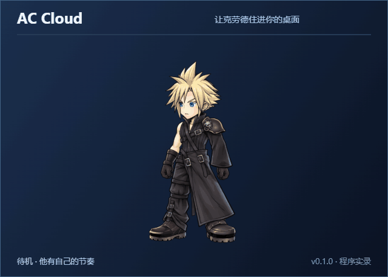

<div align="center">

# AC Cloud

**让克劳德住进你的桌面。**

以《FINAL FANTASY VII: Advent Children》克劳德为主题的非官方 Live2D 桌宠。会发呆、接花、骑上芬里尔，也会对你的打扰作出回应。

<a href="https://github.com/harry34124/AC-Cloud/releases/download/v0.1.0/AC-Cloud-v0.1.0-windows-x64.zip"></a>

[下载页 / 历史版本](https://github.com/harry34124/AC-Cloud/releases) · [怎么玩](#怎么玩) · [继续开发](#继续开发) · [反馈问题](https://github.com/harry34124/AC-Cloud/issues)



<sub>来自 v0.1.0 的真实模型与动作：待机 → 轻点回应 → 爱丽丝黄花。展示背景仅用于预览，桌面上的人物背景透明。</sub>

</div>

## 下载后，三步开始

1. **点击上方蓝色下载按钮**，获取 Windows 64 位完整运行包：`AC-Cloud-v0.1.0-windows-x64.zip`，约 **204 MB**。
2. 右键 ZIP，选择 **全部解压**，放到你喜欢的文件夹。
3. 打开解压后的 `AC Cloud` 文件夹，双击 **AC Cloud.exe**。

**不用安装开发工具，解压就能玩。** 运行环境、模型和动作已经放进包里，启动和播放不需要联网。首次启动会先准备资源，稍等几秒就会出现。

保留 EXE 同目录的 `resources`、DLL、`locales` 等文件；不要只拿走 EXE，也不要直接在压缩包内启动。只想玩的话，选择 **windows-x64.zip**，不用下载 `source.zip` 或 GitHub 自动生成的 `Source code`。

## 怎么玩

| 想做什么 | 这样操作 |
|---|---|
| 和他打招呼 | 轻点身体，他会作出回应。 |
| 摸摸头 | 轻点头部，他可能避让、整理头发；怒气较高时会反制。 |
| 把他提起来 | 按住人物并拖动，松手可放下或抛出；向左墙边抛出可衔接蹬墙动作。 |
| 主动选一个动作 | **右键怒气浮标 → 选择动作**，选中就播放，也可以打断当前动作。 |
| 调整大小、置顶或台词 | 右键怒气浮标打开菜单。人物大小可调 **100–300 px**，大小和位置会自动保存。 |
| 清空怒气 | **左键双击怒气浮标**，不用等当前动作结束。 |
| 移动浮标 | 按住浮标拖动到合适的位置。 |
| 退出桌宠 | 在浮标菜单或系统托盘菜单中选择 **退出**。 |

菜单里的 **「玩法与操作」** 可以随时重看提示。按 **Esc** 收起菜单或帮助窗口。

### 不点他，也会自己活动

默认开启自动动作：他会按概率选择日常动作，结束后继续选择下一段；偶尔也会正常待机一会儿。想让他安静一点，可以在浮标菜单关闭自动动作，或暂停动作。

- **日常陪伴**：看手机、轻叹、站着打盹、按翘发、爱丽丝黄花、接花瓣、伸手接雨……
- **芬里尔骑行**：出发、返回、烧胎、车旁养神。选中 **「骑车互动（可提车）」** 后，还可以提车头、车尾或整车。
- **战斗演出**：拔剑收剑、不悦警告、弹反斩击、凶斩、超究武神霸斩等。
- **鼠标互动**：提起、抛落、墙边翻转与落地，随你的操作衔接。

菜单现有 [27 项动作](docs/ACTIONS.md)，另含基础待机、轻点回应和 SI01–SI04 鼠标动作组。

### 留意他的怒气

<p align="center">
  
  &nbsp; → &nbsp;
  
  &nbsp; → &nbsp;
  
  &nbsp; → &nbsp;
  
  &nbsp; → &nbsp;
  
</p>

浮标会随着怒气改变图案和颜色，越生气越偏红。点击、提起和主动点播动作会增加怒气；停止打扰后会慢慢消退。

怒气较高时，他很可能先避让或向真实鼠标位置弹反，这次操作就不会再变成普通点击或抓取。想重新好好相处，**双击浮标清零**就行。

## 遇到问题

<details>
<summary><strong>找不到菜单 / 想退出</strong></summary>

右键的是**圆形怒气浮标**。也可以在 Windows 右下角系统托盘找到 AC Cloud 图标；图标可能收在「显示隐藏的图标」里。菜单里可以退出桌宠。

</details>

<details>
<summary><strong>下载了却打不开</strong></summary>

确认下载的是 **Windows 完整运行包**，已经全部解压，并保留了 EXE 旁边的资源文件夹和 DLL。源码压缩包供开发使用，不能直接当作完整程序运行。

仍有问题时，请到 [Issues](https://github.com/harry34124/AC-Cloud/issues) 留下 Windows 版本、显示缩放、动作名称和复现步骤。

</details>

<details>
<summary><strong>当前版本说明</strong></summary>

当前公开版本为 **v0.1.0 · Windows x64**。A10「脱戴右手套」仍保留“需要调整／人工检查”标记，供手动复查，暂不进入自动动作池。菜单中能播放，不代表该项已经重新获得人工验收。

本版本提供的是当前已接入桌面的内容，完整制作档案中的其他候选不代表已经包含在程序里。下载页提供 SHA256 清单，便于核对文件。

</details>

## 继续开发

直接克隆[本仓库](https://github.com/harry34124/AC-Cloud)，或下载 [v0.1.0 精简源码包](https://github.com/harry34124/AC-Cloud/releases/download/v0.1.0/AC-Cloud-v0.1.0-source.zip)。包含可编辑代码、模型、动作和资源映射，**不含完整原始 PSD / CMO、历史候选或作者开发工具**。

<details>
<summary><strong>展开源码运行与打包说明</strong></summary>

安装带 npm 的 Node.js，在仓库根目录运行：

```powershell
npm install
npm start
```

开发依赖固定为 Electron **33.2.0**，第一次安装依赖需要下载。主要代码在 `app/desktop/`，资源在 `app/assets/`，通过 `app/release-manifest.json` 映射；不依赖作者机器上的项目路径。

有意修改应用文件后，先更新校验再运行：

```powershell
python scripts/update_manifest.py
npm start
```

准备 Python 3 和 Windows Electron 33.2.0 运行时目录，即可构建完整运行包：

```powershell
python scripts/build_portable.py --electron "D:\Tools\electron-v33.2.0-win32-x64" --zip
```

详见 [开发说明](docs/DEVELOPMENT.md) 和 [动作清单](docs/ACTIONS.md)。

</details>

## 关于这个项目

AC Cloud 是非官方二创项目，与 Square Enix、Live2D 官方没有隶属或背书关系。角色、美术、模型和第三方运行库各有对应的权利与许可范围，不将整个仓库或全部素材视为 MIT 授权。

[版权说明](NOTICE.md) · [第三方组件与许可证](THIRD_PARTY_NOTICES.md) · [问题反馈](https://github.com/harry34124/AC-Cloud/issues)
